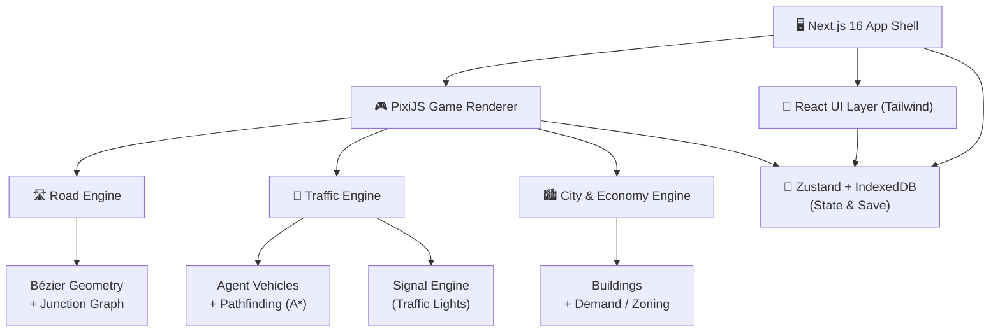
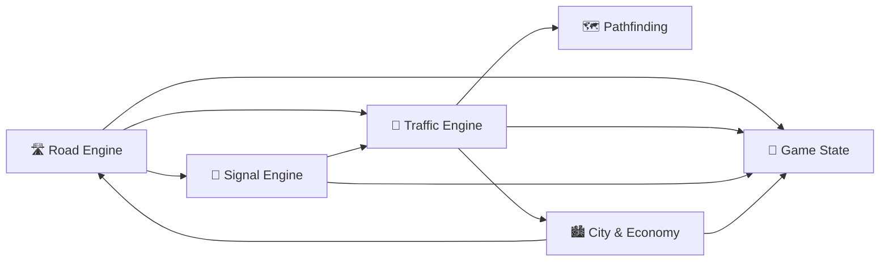
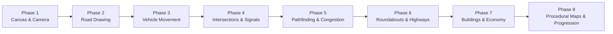

# 🚦 Game City — Traffic Simulator Development Plan

> Inspired by **Trafficity** · Browser-based · Next.js + PixiJS + Agent-based simulation

---

## 🗺️ Project Overview

A 2D top-down city traffic simulator built for the browser. Players draw roads, configure intersections and signals, watch microscopic agent vehicles navigate the city, and solve emergent congestion puzzles.



---

## 🧱 Technology Stack

| Layer         | Technology                    | Reason                                      |
| ------------- | ----------------------------- | ------------------------------------------- |
| Framework     | **Next.js 16** + React 19     | App shell, routing, SSR-optional            |
| Language      | **JavaScript (JSX)**          | Broad ecosystem, rapid iteration            |
| Rendering     | **PixiJS v8**                 | WebGL/WebGPU, thousands of sprites at 60fps |
| Road Geometry | **Custom Bézier curves**      | Free-form road drawing without grid lock    |
| Pathfinding   | **A\* on lane graph**         | Traffic-aware route selection               |
| Traffic Sim   | **Custom agent-based engine** | Microscopic vehicle behaviour               |
| Signals       | **Custom FSM**                | Per-intersection phase management           |
| UI            | **Tailwind CSS + Lucide**     | Declarative, themeable HUD                  |
| State         | **Zustand**                   | Lightweight, slice-friendly                 |
| Persistence   | **IndexedDB**                 | In-browser save/load without a backend      |

---

## 🏗️ Architecture — Six Independent Systems



### 1. Road Engine

- Bézier-curve road segments with configurable lane count
- Junction / intersection detection and merging
- Roundabout geometry helper
- Lane-level graph (nodes = waypoints, edges = drivable connections)
- Road snap-to-grid + freeform draw modes
- Support for highways (limited access, speed boost), bridges (elevation layer)

### 2. Traffic Engine (Agent-based)

- Each vehicle is an independent agent with position, velocity, heading
- **IDM** (Intelligent Driver Model) for car-following behaviour
- Lane-change decisions (MOBIL or simplified)
- Queue / congestion propagation
- Emergency braking and gap acceptance at merges

### 3. Pathfinding

- Graph built from Road Engine lane waypoints
- **A\* with traffic-weighted heuristic** (congestion penalty on edge cost)
- Vehicles re-route dynamically when congestion changes
- Destination selection driven by City & Economy (home ↔ work ↔ shop)

### 4. Signal Engine

- Per-intersection finite state machine (phases: green/yellow/red)
- Fixed-time cycles + future adaptive control mode
- Pedestrian crossing phases
- API for player to edit timing in HUD

### 5. City & Economy Engine

- Zoning: Residential 🏠, Commercial 🏪, Industrial 🏭
- Building demand generated by zone imbalances
- Trip generation: residents commute to jobs, deliveries to commercial
- Population and happiness metrics → unlock progression

### 6. Game State & Persistence

- Zustand slices: `roads`, `vehicles`, `signals`, `city`, `ui`, `settings`
- Tick-based simulation loop decoupled from React render
- Serialise to IndexedDB on save; deserialise on load
- Multiple save slots + autosave

---

## 📅 Development Roadmap — 8 Phases



---

### ✅ Phase 1 — Canvas, Camera, Map

**Goal:** Blank world you can navigate.

- [ ] Init Next.js 16 project with App Router
- [ ] Mount PixiJS canvas inside a React component (no React re-renders per frame)
- [ ] Infinite panning (drag) + smooth zoom (scroll wheel / pinch)
- [ ] World coordinate ↔ screen coordinate transforms
- [ ] Ground tile / grid background
- [ ] FPS counter overlay

**Exit criteria:** Pan and zoom a blank map at 60 fps.

---

### 🛣️ Phase 2 — Road Drawing & Editing

**Goal:** Player can draw, edit and delete roads.

- [ ] Road draw tool: click start → drag curve handle → click end → place Bézier segment
- [ ] Lane count picker (1–4 lanes each direction)
- [ ] Visual road rendering: asphalt fill, lane markings, kerbs
- [ ] Snap-to-existing-road for junction creation
- [ ] Junction node detection + auto-merge
- [ ] Road delete tool
- [ ] Undo / redo stack

**Exit criteria:** Draw a road network; intersections form automatically.

---

### 🚗 Phase 3 — Vehicle Movement & Turning

**Goal:** Cars drive along roads.

- [ ] Waypoint extraction from Bézier lanes
- [ ] Vehicle spawn point (bus stop / depot)
- [ ] Agent follows waypoints with heading interpolation
- [ ] IDM car-following (speed, braking, gap)
- [ ] Smooth turning at junctions
- [ ] Vehicle sprites (car, bus, truck) with direction rotation
- [ ] Debug overlay: vehicle velocity vectors

**Exit criteria:** Vehicles drive a loop and queue behind each other.

---

### 🚦 Phase 4 — Intersections & Traffic Lights

**Goal:** Controlled intersections work correctly.

- [ ] Traffic light placement tool
- [ ] Signal FSM: green → yellow → red per phase
- [ ] Multi-phase cycle editor in HUD (drag timing bars)
- [ ] Vehicle yield logic at red lights (full stop before stop line)
- [ ] Priority yield at uncontrolled junctions (right-of-way)
- [ ] Visual signal heads on roads

**Exit criteria:** Vehicles obey signals; player can tune cycle lengths.

---

### 🗺️ Phase 5 — Pathfinding & Congestion

**Goal:** Vehicles route intelligently and congestion emerges.

- [ ] Build lane-graph from Road Engine after every edit
- [ ] A\* pathfinding with congestion-weighted costs
- [ ] Vehicles select origin/destination pairs
- [ ] Dynamic re-routing when congestion threshold exceeded
- [ ] Congestion heatmap overlay (green → yellow → red)
- [ ] Bottleneck analytics panel

**Exit criteria:** Traffic jams form; vehicles reroute around them.

---

### 🔄 Phase 6 — Roundabouts & Highways

**Goal:** Advanced road types.

- [ ] Roundabout geometry tool (circular road with yield-to-circulating rule)
- [ ] Highway segment (limited access, higher speed limit, no signals)
- [ ] On-ramp / off-ramp lane merge geometry
- [ ] Bridge layer (roads cross without intersecting)
- [ ] Speed limit signs (visual + simulation effect)

**Exit criteria:** Roundabout routes traffic smoothly; highways carry high throughput.

---

### 🏙️ Phase 7 — Buildings & City Economy

**Goal:** The city generates its own traffic demand.

- [ ] Zone brush: paint Residential / Commercial / Industrial areas
- [ ] Building procedural placement within zones
- [ ] Trip generator: morning peak (home → work), evening peak (work → home)
- [ ] Delivery trucks: industrial → commercial
- [ ] Satisfaction meter: low congestion = happy residents
- [ ] Unlock system: meet satisfaction targets to expand city boundary

**Exit criteria:** City generates organic rush-hour peaks without player spawning cars.

---

### 🌍 Phase 8 — Procedural Maps & Progression

**Goal:** Replayable content and meta-progression.

- [ ] Procedural city layout generator (seed-based, Voronoi districts)
- [ ] Scenario / challenge mode (fix this broken city in N minutes)
- [ ] Progression tree: unlock road types, signal modes, building types
- [ ] Statistics dashboard: avg. travel time, throughput, emissions
- [ ] Map share via URL-encoded save (compressed JSON)
- [ ] Leaderboard (optional backend or Supabase)

**Exit criteria:** New procedural map every run; scenarios are winnable.

---

## 📁 Project Structure

```
game-city/
├── app/                        # Next.js App Router
│   ├── page.jsx                # Entry → mounts GameCanvas
│   ├── layout.jsx
│   └── globals.css
├── components/
│   ├── GameCanvas.jsx          # PixiJS mount point
│   └── HUD/                   # React UI overlays
│       ├── Toolbar.jsx
│       ├── SignalEditor.jsx
│       ├── StatsPanel.jsx
│       └── MiniMap.jsx
├── engine/
│   ├── core/
│   │   ├── GameLoop.js         # requestAnimationFrame tick
│   │   └── EventBus.js         # engine ↔ UI messaging
│   ├── road/
│   │   ├── RoadEngine.js
│   │   ├── BezierGeometry.js
│   │   └── LaneGraph.js
│   ├── traffic/
│   │   ├── TrafficEngine.js
│   │   ├── Vehicle.js          # IDM agent
│   │   └── VehiclePool.js      # object pooling
│   ├── pathfinding/
│   │   ├── AStar.js
│   │   └── CongestionMap.js
│   ├── signal/
│   │   └── SignalEngine.js
│   └── city/
│       ├── CityEngine.js
│       ├── ZoneManager.js
│       └── TripGenerator.js
├── renderer/
│   ├── PixiRenderer.js         # PixiJS stage setup
│   ├── RoadRenderer.js
│   ├── VehicleRenderer.js
│   ├── SignalRenderer.js
│   └── BuildingRenderer.js
├── store/
│   ├── useGameStore.js         # Zustand root store
│   ├── slices/
│   │   ├── roadSlice.js
│   │   ├── trafficSlice.js
│   │   ├── signalSlice.js
│   │   └── citySlice.js
│   └── persistence.js          # IndexedDB save/load
├── public/
│   └── assets/
│       ├── sprites/            # vehicle, building sprites
│       └── textures/           # road, ground textures
└── package.json
```

---

## 🔑 Key Design Decisions

| Decision        | Choice                           | Rationale                                             |
| --------------- | -------------------------------- | ----------------------------------------------------- |
| Rendering loop  | PixiJS ticker, never React state | React re-renders would cap to ~30fps                  |
| Road model      | Bézier + lane graph              | Free-form roads; graph enables A\*                    |
| Vehicle physics | IDM (no Box2D)                   | Lightweight; IDM is industry standard for traffic sim |
| State bridge    | EventBus (engine → Zustand)      | Decouples 60fps engine from React UI                  |
| Save format     | Compressed JSON → IndexedDB      | No backend needed; shareable via URL                  |
| Build tool      | Next.js + Turbopack              | Fast HMR during development                           |

---

> [!IMPORTANT]
> **Build order is critical.** Phases 1–5 (rendering + roads + vehicles + signals + pathfinding) must be solid before touching Phase 7 (economy). A buggy traffic engine makes everything downstream unreliable.

> [!TIP]
> Use **object pooling** for vehicles from day one (`VehiclePool.js`). Spawning/destroying hundreds of JS objects per second causes GC pauses that break the simulation feel.

> [!NOTE]
> The simulation tick and the render tick can run at different rates. Consider running the simulation at a fixed 20 Hz and rendering at 60 Hz with interpolation — this makes the sim deterministic and easier to debug.
